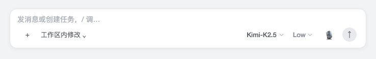
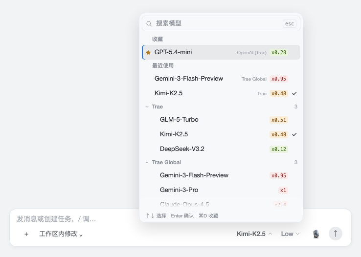
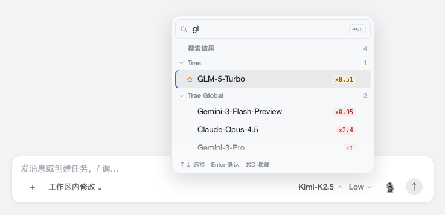
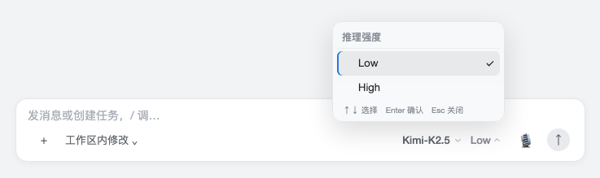
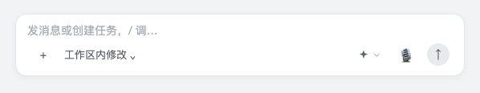
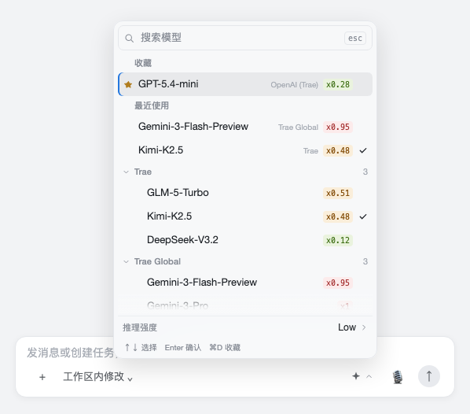
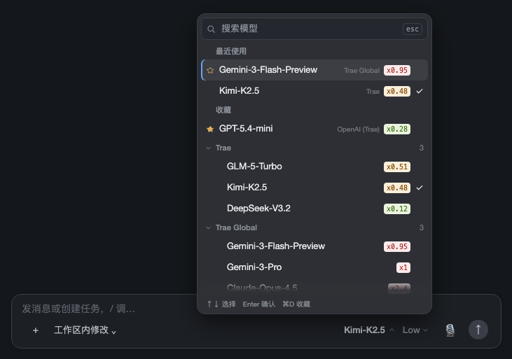

# DSH Quick Model Selector

English · [中文](README.md)

Takes over the model seat at the bottom right of the DSH composer: instead of one long flat list of every provider, you get a search-first panel with favorites and recents pinned on top, collapsed provider groups, and reasoning effort as a separate second control. Built for setups with dozens or hundreds of models.

The composer has two independent controls, each with its own hit area and popover:





## Features

- **Search first** — the panel opens with the cursor in the search box. Matching covers model name, provider name and model id; space-separated terms are ANDed.
- **Favorites and recents** — your handful of everyday models stay at the top.
- **Collapsible groups** — providers with more than six models start collapsed; the group holding the current model or a favorite stays open, and manual folding is remembered.
- **Multiplier badges** — an `x0.28` token in the model name becomes a row-end badge, colored ≤0.3 green, ≤0.8 amber, >0.8 red.
- **Separate reasoning effort** — its own button, popover and focus; hidden entirely when the current model has no reasoning support.
- **Keyboard** — `⌘1–⌘9` quick pick, `⌘D` favorite, `Tab` fold, arrows plus Enter.





When the control row cannot fit two controls, the model button becomes an icon and effort moves to a row at the bottom of the menu:





Same layout in dark theme:



## Install

**Plugin page (recommended)** — Settings → Plugins → Add plugin, and put this in "package name or address":

```
https://github.com/SnailMann/dsh-quick-model-selector
```

Then restart DSH Desktop once as prompted. The plugin appears as "快捷模型选择器" / "Quick Model Selector" under installed plugins and can be toggled or removed at any time.

**Command line** — same thing, where `web` is the profile DSH Desktop uses:

```sh
dsh plugin --profile web add github:SnailMann/dsh-quick-model-selector
```

`dist/` is committed, so installing needs no build step and triggers no pnpm build-script approval.

**From source** — when you want to change the code:

```sh
git clone https://github.com/SnailMann/dsh-quick-model-selector.git
cd dsh-quick-model-selector
dsh plugin --profile web add .
```

After editing `src/`, run `npm run build` and restart DSH.

Verified on DSH Desktop 0.12.1 / Harness 0.2.1-rc.2: visible and toggleable in the plugin list, one composed plugin row when enabled and none when disabled.

## Usage

Click the model button at the bottom right of the composer; the rest is in this table:

| Key | Action |
| --- | --- |
| Typing | Filters the list |
| ↑ / ↓ | Move the highlight (focus stays in the search box) |
| Enter | Select the highlighted row |
| Esc | Clears the search term first, closes on the second press; closes directly inside the effort popover |
| Tab | Fold / unfold the provider group of the highlighted row |
| ⌘1 – ⌘9 (or Ctrl+1–9) | Pick the Nth visible row |
| ⌘D (or Ctrl+D) | Favorite / unfavorite the highlighted row |

The mouse works too: click a row to select, click the star to favorite, click a group header to fold.

Preferences live in `localStorage` under `dsh-quick-model-selector:prefs:v1`, shared across sessions; upgrading from the old package name `dsh-model-palette` migrates the old key automatically, keeping favorites and folded state.

## Uninstall

```sh
dsh plugin --profile web remove dsh-quick-model-selector
```

Only its own registration is removed — sessions, model config and preferences stay, and the built-in model picker returns after a restart.

## Development

After editing `src/`, run `npm run build` then `npm test`; `node scripts/preview.mjs <dir>` renders the real components into static pages for layout work.

## License

MIT
