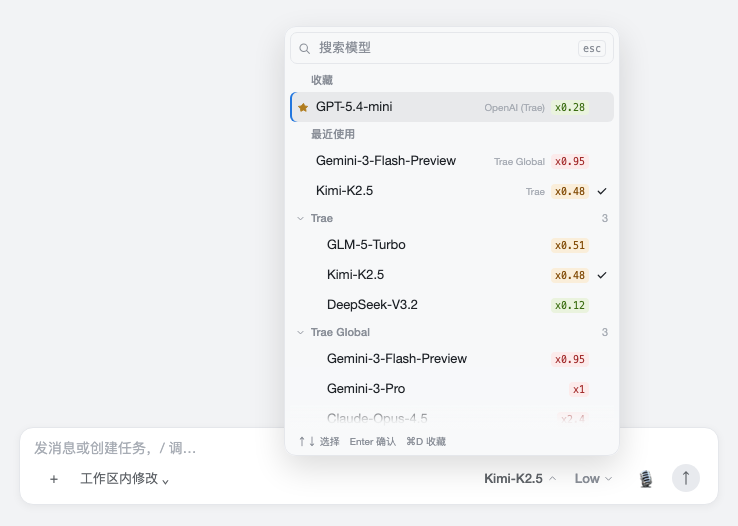
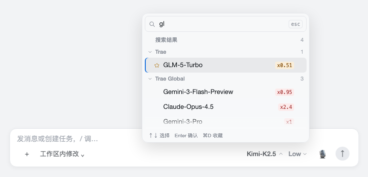
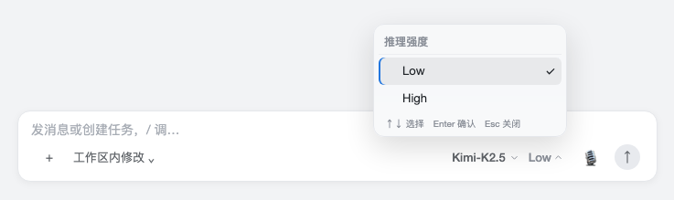
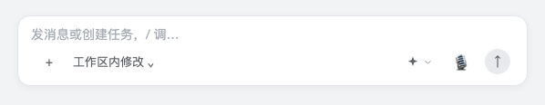
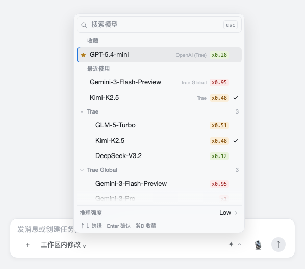
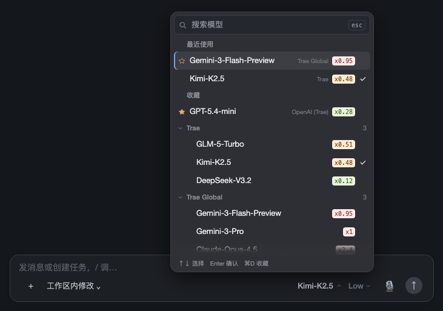

# DSH 快捷模型选择器

[English](README.en.md) · 中文


一只橘 oranji 的 DSH 插件。

**模型越来越多，切换不该越来越麻烦。**

接入了好几个 provider，模型列表越拉越长；明明只想换回刚才那个，却又得从头翻一遍。

快捷模型选择器让 DSH 里的模型更好找：刚用过的就在最上面，常用的收藏紧随其后，想找哪个就输入几个字。少翻列表，把注意力留给眼前的对话。



## 用起来有什么不同？

- **想找哪个，直接打字**：打开就能搜，输入模型名或 provider 名即可缩小范围，不必挨个展开分组。
- **常用的，不用反复找**：最近使用和收藏都置顶，刚用过的排在最前，换回上一个模型只需点一下。
- **模型再多，也有条理**：超过 6 个模型的 provider 默认收起，当前模型和收藏所在的组保持展开；你手动调整的折叠状态也会记住。
- **倍率不用藏在长名字里**：`x0.28` 这类倍率单独显示为彩色角标，扫一眼就能分辨。
- **换模型、调推理，各管各的**：推理强度有独立按钮，不必在模型列表里来回找；不支持时自动隐藏。
- **手不离键盘，也能切换**：方向键选、Enter 确认，`⌘1–⌘9` 快选、`⌘D` 收藏（也支持 Ctrl）。
- **贴齐输入栏右侧**：模型按钮按名称收紧，切换时麦克风和发送按钮保持原位。长名称用省略号收尾，悬停查看全名。窄框下模型按钮以 150px 为上限，空间不足时继续收窄，推理强度移入模型菜单。菜单会跟随按钮，在可见窗口内调整位置和高度。





窗口变窄时保留模型名，推理强度收进菜单：





深色主题同一套排版：



## v1.0.2

- 模型按钮贴齐输入栏右侧。窄窗将推理强度收入菜单，切换模型时麦克风和发送按钮保持原位。
- 模型和推理强度菜单跟随按钮，随窗口缩放调整位置和高度，避免边缘裁切和突然位移。
- 收藏和目录更新保留正确的键盘高亮。切换失败时可重试，迟到的响应不会打断重新打开的菜单。

## 安装

**插件页（推荐）**：设置 → 插件 → 添加插件 → 「包名或地址」填

```
https://github.com/SnailMann/dsh-quick-model-selector
```

装完按提示重启一次 DSH Desktop。重启后在「已安装插件」里能看到 `dsh-quick-model-selector`，可随时开关或卸载。

**命令行**（等价，`web` 是 Desktop 用的 profile 名）：

```sh
dsh plugin --profile web add github:SnailMann/dsh-quick-model-selector
```

`dist/` 已随仓库提交，安装不需要编译，也不会触发 pnpm 的构建脚本审批。

**从源码**（想改代码时）：

```sh
git clone https://github.com/SnailMann/dsh-quick-model-selector.git
cd dsh-quick-model-selector
dsh plugin --profile web add .
```

改完 `src/` 要 `npm run build` 再重启 DSH。

v1.0.2 已在 DSH Desktop 0.14.0 / Harness 0.2.2-rc.1 验证。插件列表可见，启用时装配一条插件行，停用时不装配。

## 使用

点输入框右下角的模型按钮，剩下的都在表里：

| 键 | 行为 |
| --- | --- |
| 直接打字 | 过滤列表 |
| ↑ / ↓ | 移动高亮（焦点留在搜索框） |
| Enter | 选中当前高亮 |
| Esc | 先清空搜索词，再按一次关闭；在强度弹层里直接关闭 |
| Tab | 无搜索词时折叠 / 展开当前分组；连续按可恢复刚折叠的组（Shift+Tab 返回前一个控件） |
| ⌘1 – ⌘9（或 Ctrl+1–9） | 直选第 N 个可见项 |
| ⌘D（或 Ctrl+D） | 收藏 / 取消收藏当前高亮 |

鼠标同样可用：点行选中、点星标收藏、点分组头折叠。

偏好存在 `localStorage` 的 `dsh-quick-model-selector:prefs:v1`，全局共享、不区分会话；从旧包名 `dsh-model-palette` 升级时旧键会自动迁移，收藏与折叠状态不丢。

## 卸载

```sh
dsh plugin --profile web remove dsh-quick-model-selector
```

只移除自身登记，会话、模型配置和偏好都保留；重启后恢复官方模型选择器。

## 开发

改 `src/` 后 `npm run build` 再 `npm test`；`node scripts/preview.mjs <dir>` 可把真实组件渲染成静态页看排版。

浏览器交互测试使用本机 DSH 的 React 和 Playwright，覆盖键盘操作、320–800px 工具栏宽度、模型切换时的位置稳定性，以及带裁切和位移的宿主布局中的弹层边界。通过 `NODE_PATH` 提供 Playwright 后运行 `npm test`；使用系统 Chrome 时加上 `QMS_BROWSER_CHANNEL=chrome`。可用 `DSH_PROFILE_MODULES` 指向 DSH 随附的 React 模块目录。缺少依赖时会明确跳过浏览器测试，不能替代真实 DSH 验证。静态预览不执行布局观察器，响应式行为以浏览器测试和真实宿主为准。

在 macOS 上可用 DSH Desktop 自带的 Electron 运行 `ELECTRON_RUN_AS_NODE=1 "$DSH_DESKTOP_EXECUTABLE" test/host-registration.mjs`。将 `DSH_DESKTOP_EXECUTABLE` 指向应用的可执行文件。测试使用临时 profile 验证插件清单和启停装配。

## License

MIT
